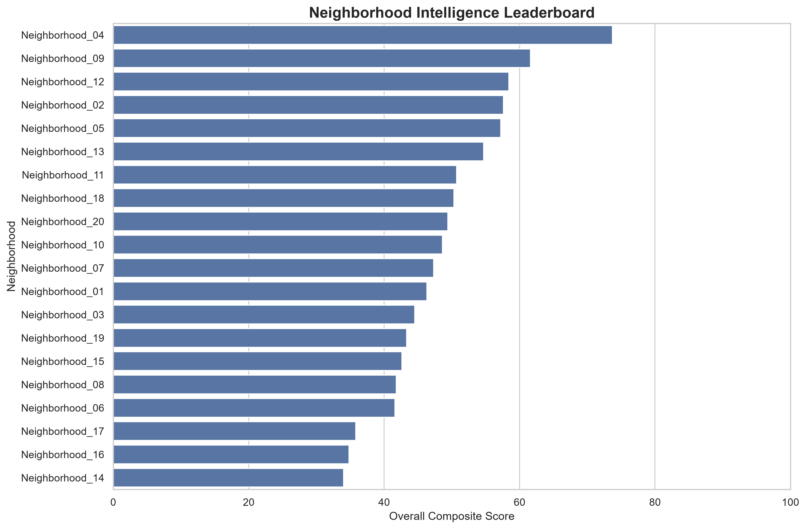
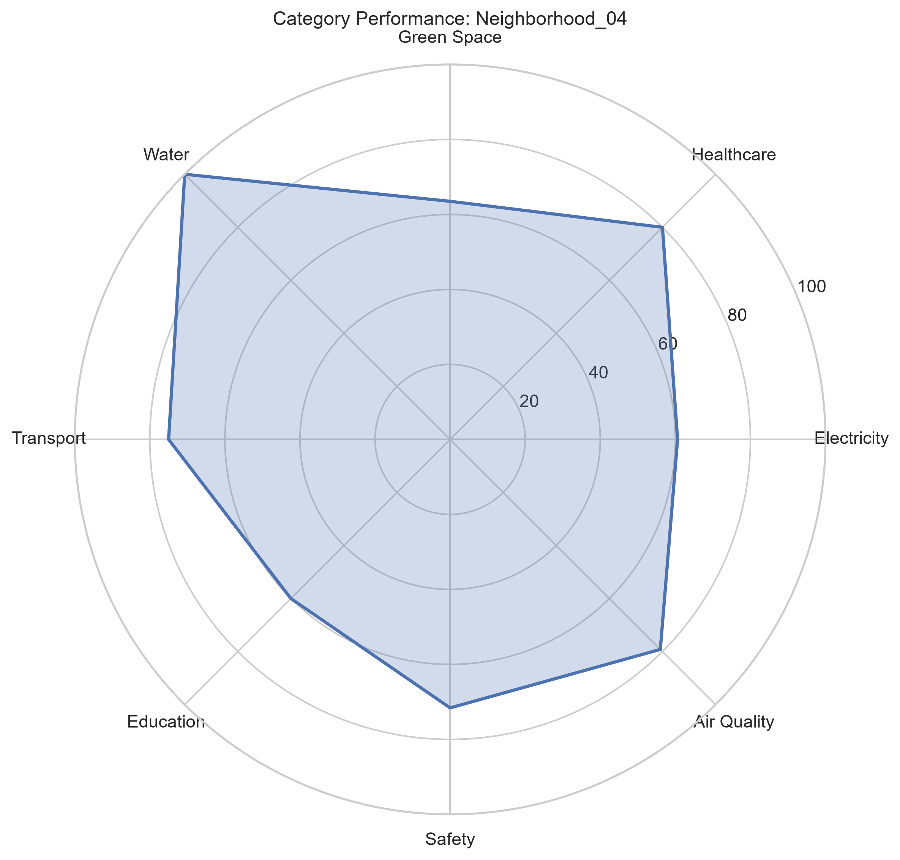
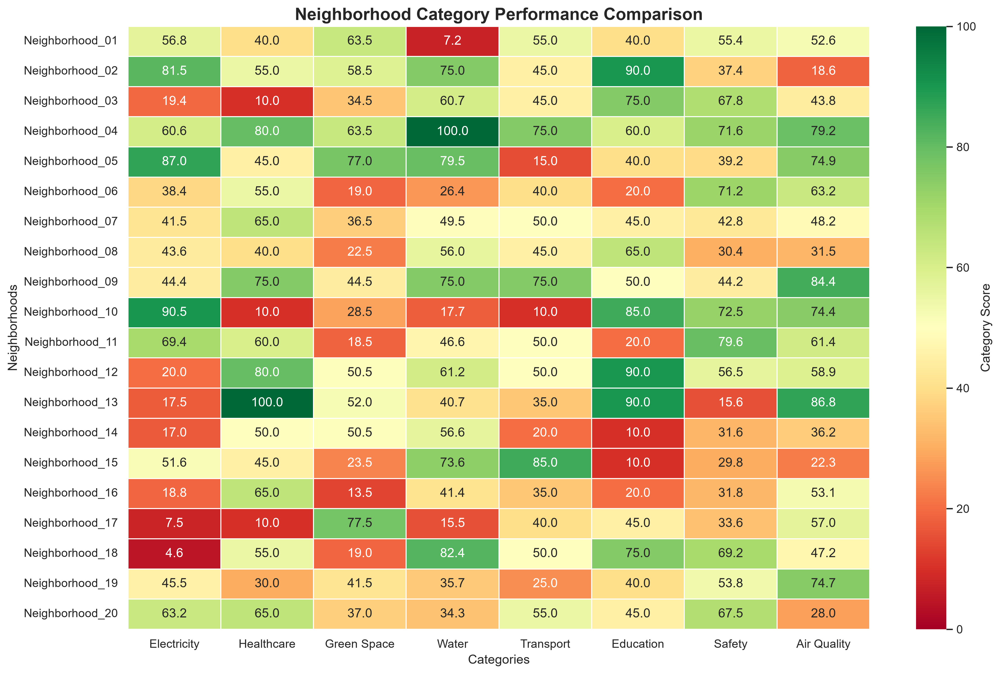

# Neighborhood Intelligence System v0.1

## Overview

The Neighborhood Intelligence System (NIS) is a data-driven project designed to evaluate and compare neighborhoods using multiple quality-of-life indicators.

The system processes neighborhood-level data, normalizes different feature values, calculates category-wise scores, and generates an overall composite score to rank neighborhoods.

The current version uses a synthetic dataset containing 20 fictional neighborhoods and 16 input features.

## Objectives

- Evaluate neighborhoods using multiple quality-of-life indicators.
- Normalize features with different measurement scales.
- Calculate category-wise performance scores.
- Generate overall composite scores.
- Compare and rank neighborhoods through visualizations.

## Features

The system evaluates 16 features across eight categories.

| Category | Features |
|---|---|
| Education | School Density, School Distance |
| Healthcare | Hospital Density, Hospital Distance |
| Safety | Crime Rate, Crime Trend |
| Air Quality | Average AQI, Poor Air Days |
| Water | Water Supply Days, Water Interruptions |
| Electricity | Power Outages, Power Outage Hours |
| Transport | Bus Stop Density, Transit Distance |
| Green Space | Green Coverage, Green Space Per Capita |

## Methodology

### 1. Feature Configuration
Defines the category, minimum value, maximum value, and optimization direction for each feature.

### 2. Synthetic Dataset Generation
Generates data for 20 fictional neighborhoods using NumPy.

### 3. Normalization Engine
Uses Min-Max normalization to convert feature values into a common scale of 0 to 100.

Higher-is-better and lower-is-better features are handled separately.

### 4. Category Aggregation
Groups normalized features into eight categories and calculates average category scores using equal weighting.

### 5. Overall Composite Scoring
Calculates the final neighborhood score by averaging the eight category scores and ranks neighborhoods accordingly.

### 6. Data Visualization
The project includes four visualizations:

- Neighborhood Intelligence Leaderboard
- Category Performance Radar Chart
- Neighborhood Comparison Heatmap
- Overall Score Distribution

## Visualizations

### Neighborhood Leaderboard


### Category Performance Radar Chart


### Neighborhood Comparison Heatmap


### Overall Score Distribution


## Technology Stack

- Python
- Pandas
- NumPy
- Matplotlib
- Seaborn
- Jupyter Notebook

## Installation

Clone the repository:

```bash
git clone https://github.com/YOUR_USERNAME/neighborhood-intelligence-system.git
```

Navigate to the project directory:

```bash
cd neighborhood-intelligence-system
```

Install dependencies:

```bash
pip install -r requirements.txt
```

Launch Jupyter Notebook:

```bash
jupyter notebook
```

Open `Neighborhood_Intelligence_System_v0.1.ipynb` and execute the cells sequentially.

## Dataset

The current implementation uses synthetic data generated using NumPy.

- 20 fictional neighborhoods
- 16 input features
- 8 evaluation categories

The dataset is intended for demonstrating the scoring methodology and does not represent actual neighborhood statistics.

## Current Limitations

- Uses synthetic rather than real-world data.
- Applies equal weighting to all features within categories.
- Applies equal weighting to all eight categories.
- Does not currently include an interactive dashboard.

## Future Improvements

- Integrate real-world neighborhood datasets.
- Introduce configurable feature and category weights.
- Develop an interactive dashboard.
- Add neighborhood selection and comparison.
- Improve scoring methodology and validation.

## Project Status

**Version:** v0.1

**Status:** Initial Prototype

The core scoring pipeline and four visualizations have been implemented using synthetic neighborhood data.
