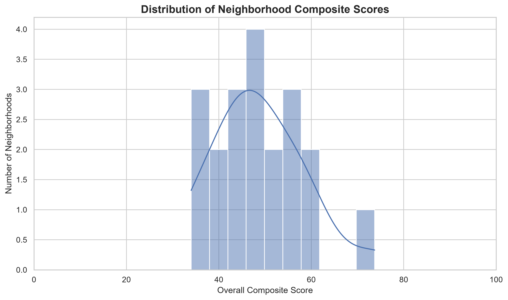
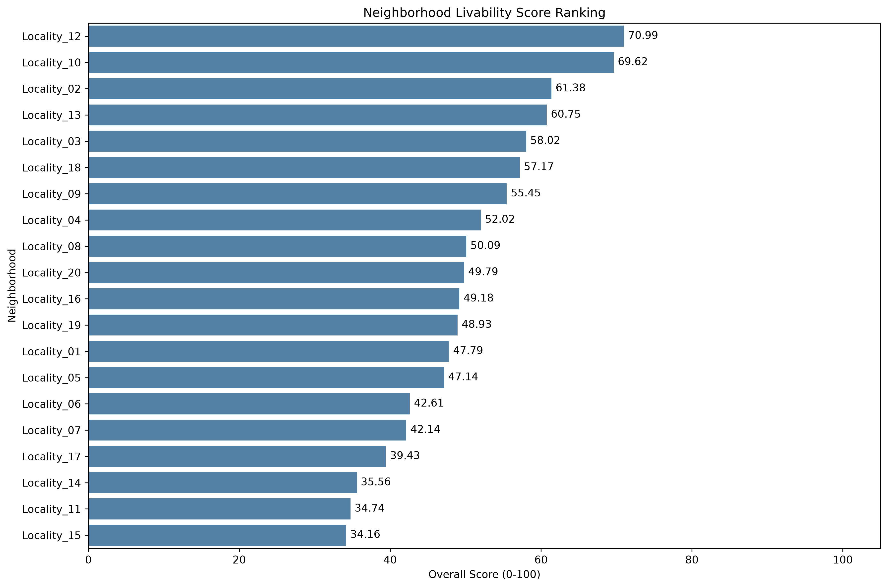

# Neighborhood Intelligence System (NIS)

## Overview

The Neighborhood Intelligence System (NIS) is a data-driven project designed to evaluate and compare neighborhoods using multiple quality-of-life indicators.

The system processes neighborhood-level data, normalizes different feature values, calculates category-wise scores, and generates an overall composite score to rank neighborhoods.

The project currently uses a synthetic dataset containing 20 fictional neighborhoods and 16 input features. Its initial geographic scope is Malout and surrounding localities, with real-world data integration planned for future versions.

**Current Version:** v0.2 — Data Engineering and Statistical Analysis

## Objectives

- Evaluate neighborhoods using multiple quality-of-life indicators.
- Generate and validate synthetic neighborhood datasets.
- Normalize features with different measurement scales.
- Calculate category-wise performance scores.
- Generate overall composite scores.
- Analyze feature distributions and correlations.
- Compare and rank neighborhoods through visualizations.
- Establish a foundation for future real-world data integration.

## Features

The system evaluates 16 features across eight categories.

| Category | Features |
|---|---|
| Education | School Density, School Distance |
| Healthcare | Hospital Density, Hospital Distance |
| Safety | Crime Rate, Crime Trend |
| Air Quality | Average AQI, Poor Air Days |
| Water | Water Supply Days, Water Interruptions |
| Electricity | Power Outages, Power Outage Hours |
| Transport | Bus Stop Density, Transit Distance |
| Green Space | Green Coverage, Green Space Per Capita |

## Methodology

### 1. Feature Configuration

Defines the category, minimum value, maximum value, and optimization direction for each feature.

### 2. Feature Metadata

Maintains feature descriptions, measurement units, and data types to improve consistency and interpretability.

### 3. Synthetic Dataset Generation

Generates data for 20 fictional neighborhoods using NumPy, with category-based quality profiles and controlled variation.

### 4. Data Validation

Checks the generated dataset for:
- Missing values
- Duplicate neighborhood IDs and names
- Missing feature columns
- Values outside configured ranges
- Data type inconsistencies

### 5. Exploratory Data Analysis

Uses summary statistics, histograms, boxplots, and correlation analysis to examine feature distributions, variability, and relationships.

### 6. Normalization Engine

Uses Min-Max normalization to convert feature values into a common scale of 0 to 100.

Higher-is-better and lower-is-better features are handled separately.

### 7. Category Aggregation

Groups normalized features into eight categories and calculates average category scores using equal weighting.

### 8. Overall Composite Scoring

Calculates the final neighborhood score by averaging the eight category scores and ranks neighborhoods accordingly.

### 9. Scoring Validation and Visualization

Validates score ranges, missing values, ranking uniqueness, and ranking order. Generates visualizations to compare neighborhood performance.

## Visualizations

### v0.1 — Initial Prototype

**Neighborhood Leaderboard**


**Category Performance Radar Chart**


**Neighborhood Comparison Heatmap**


**Overall Score Distribution**



### v0.2 — Data Engineering and Statistical Analysis

**Neighborhood Livability Leaderboard**



## Dataset

The current implementation uses synthetic data generated using NumPy.

- 20 fictional neighborhoods
- 16 input features
- 8 evaluation categories
- Assessment period: 2025
- Data source: Synthetic

### Processed Datasets

The `data/processed/` directory contains:

| File | Description |
|---|---|
| `nis_v02_synthetic_data.csv` | Generated raw neighborhood dataset |
| `nis_v02_normalized_data.csv` | Dataset containing normalized feature scores |
| `nis_v02_neighborhood_rankings.csv` | Final category scores, overall scores, and neighborhood rankings |

**Important:** The dataset is synthetic and does not represent actual neighborhood statistics from Malout or any other location. Its statistical relationships are designed for development and testing.

## Scoring Methodology

The current scoring model uses:

- Min-Max normalization with a 0–100 scale.
- Equal weighting of features within each category.
- Equal weighting of all eight categories in the overall score.
- Arithmetic mean for category and overall score aggregation.

### Methodological Limitations

- **Equal Weighting:** Assumes all features and categories have equal importance.
- **Feature Correlation:** Highly correlated features may contribute overlapping information to the final score.
- **Linear Normalization:** Assumes a linear relationship between feature values and their corresponding scores.
- **Synthetic Data:** Generated relationships and rankings cannot establish real-world neighborhood conditions or predictive accuracy.

## Technology Stack

- Python
- Pandas
- NumPy
- Matplotlib
- Seaborn
- Jupyter Notebook

## Project Structure

```text
Neighborhood-Intelligence-System/
│
├── data/
│   ├── raw/
│   └── processed/
│       ├── nis_v02_synthetic_data.csv
│       ├── nis_v02_normalized_data.csv
│       └── nis_v02_neighborhood_rankings.csv
│
├── screenshots/
│   ├── heatmap_v0.1.png
│   ├── leaderboard_v0.1.png
│   ├── radar_chart_v0.1.png
│   ├── score_distribution_v0.1.png
│   └── Neighborhood_Livability_Leaderboard_v0.2.png
│
├── .gitignore
├── Neighborhood_Intelligence_System_v0.1.ipynb
├── Neighborhood_Intelligence_System_v0.2.ipynb
├── README.md
└── requirements.txt
```

## Installation

Clone the repository:

```bash
git clone https://github.com/Rehaan-0211/Neighborhood-Intelligence-System.git
```

Navigate to the project directory:

```bash
cd Neighborhood-Intelligence-System
```

Install dependencies:

```bash
pip install -r requirements.txt
```

Launch Jupyter Notebook:

```bash
jupyter notebook
```

Open the required version of the notebook and execute the cells sequentially.

## Future Improvements

- Integrate real-world neighborhood datasets.
- Establish more reliable feature definitions and scoring benchmarks.
- Investigate feature correlation and potential double counting.
- Introduce data-driven feature and category weighting.
- Improve handling of missing values and outliers.
- Explore statistical modeling and machine learning where suitable independent data is available.
- Develop an interactive dashboard.
- Add neighborhood selection and comparison.
- Implement explainability for neighborhood scores.

## Project Status

**Current Version:** v0.2

**Status:** Data Engineering and Statistical Analysis Completed

### Version History

| Version | Focus | Status |
|---|---|---|
| v0.1 | Initial scoring prototype and visualizations | Completed |
| v0.2 | Synthetic data engineering, validation, EDA, correlation analysis, and scoring pipeline | Completed |
| v0.3 | Statistical intelligence and scoring improvements | Planned |
| v0.4 | Real-world data integration | Planned |

---

**Dataset Status:** Synthetic — not representative of measured neighborhood conditions.